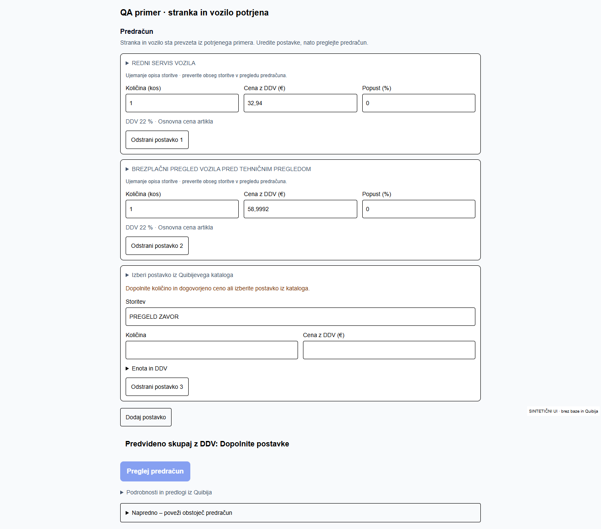
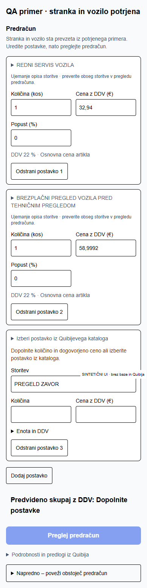
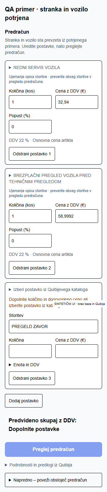

# Quibi katalog – dejansko branje 24. 10. 2026

Nov API je preverjen z obstoječimi strežniškimi DEV poverilnicami. Nobena skrivnost ni prenesena v lokalno okolje ali dokazila. Testna skripta zavrne vse metode razen GET in vse poti izven dovoljenega seznama. Ni CREATE, SEND, shranjenega osnutka ali zapisa v podatkovno bazo.

## Protokol in podatki

[Dokumentacija Quibi – Seznam artiklov](https://navodila.quibi.net/za-razvijalce/#seznam-artiklov), sveže prebrana 24. 10. s parametrom za obhod zastarelega spletnega predpomnilnika.

`GET /api2/sifranti/seznam?po=0&limit=500&arhivirano=0`

Naslednji klic uporabi vrnjeni `naslednji_po`; branje se konča izključno pri `null`, tudi kratka stran lahko ima nadaljevanje. Dokumentiran je tudi neobvezni `spremenjeno_od=YYYY-MM-DD HH:MM:SS`; tega filtra v polnem branju ne uporabljamo. Največji limit je 500. Preverjajo se ovojnica, število vrstic, napredovanje kazalca, strogi vrstni red ID-jev in podvojitve, tudi pri artiklih, ki niso vključeni v uporabniški indeks. Napaka strani zavrne celoten rezultat.

Odgovor vsebuje `data.Sifranti[]` z ovoji `Sifranti`, `Enota`, `Ddv`, `Kategorije` in `Variableproduct`. Na voljo so ID, šifra, naziv, osnovna cena brez DDV, enota, DDV in `vodiZalogo`. Aktivnost določimo z dokumentiranim filtrom `arhivirano=0`; posebnega polja vrste storitve ni. Nezalogovni artikel zato ni samodejno dokaz servisne storitve. Kategorije so lahko prazne. Polni seznam in nabor polj sta povzeta v priloženem JSON dokazilu.

## Vključitev v Selan

Strežnik prebere vse strani in sestavi majhen indeks nezalogovnih artiklov ter artiklov iz dejanskih cenikov. Brskalniku ne pošilja več kot 54 tisoč zalogovnih izdelkov. Preverjeno nezalogovno storitev brez šifre lahko pripravi kot prosto postavko z dejansko ceno, enoto in DDV iz Quibija; šifre ne izmisli.

Indeks ima strežniški predpomnilnik 15 minut in združevanje sočasnih branj. Ključ je ločen po izvoru in računu z nepovratnim povzetkom; poverilnice niso argumenti predpomnilnika. Neuspešen ali delni rezultat se ne shrani. Prvo hladno branje vseh 109 strani je počasnejše; naslednji primeri uporabljajo indeks. Inkrementalna sinhronizacija ni dodana, ker mora zajeti tudi arhiviranja.

Pri pregledu in ustvarjanju ostanejo sveži GET za izbrani aktivni artikel (omejen seznam z `po=ID-1&limit=1`), cenike, stranko, enote in DDV. Osnovna cena je ločena od cenika stranke. Neznana politika cenika ustavi pripravo; popusti in cenik se ne ugibajo. Ob spremembi poslovnih podatkov je potreben ponovni pregled. Obstoječa preverjanja identitete dokumenta in varovalke pred podvojitvijo ostajajo.

Vse tri zahtevane storitve ostanejo kot vrstice. Lokalno ujemanje brez AI ključa razume preverjene sopomenke in manjše tipkarske napake. Zanesljiva enolična ujemanja dobijo artikel in ceno. Ostala dobijo možnosti ali prosto vrstico brez izmišljene cene. Pregled zavor se ne nadomesti s pregledom podvozja ali menjavo zavor. Pozitivna cena artikla z nazivom »brezplačni« zahteva izbiro uporabnika.

## Preverjanje in omejitve

45 ponovno izvedenih ciljnih testov: paginacija, podvojitve, neveljavni kazalci, manjkajoče cene/reference, nezalogovne postavke brez šifre, ujemanje, cenik stranke, sveže preverjanje in predpomnilnik. ESLint in TypeScript uspešna. Gostovani build izvede tudi dejanski GET preizkus.

Hidrirani resnični komponenti sta preverjeni pri 1440, 390 in 350 px: tri vrstice, zanesljivo samodejno ujemanje, izbira nejasne storitve, prazna manjkajoča cena, en pregled in brez prelivanja. Posnetki uporabljajo izolirane akcijske fixture in podatke cen, prebranih iz DEV; niso prijavljena aplikacija ali dokaz CREATE.

[Rezultati komponent](../selan-estimate-workspace/browser-results.json)

Celoten prijavljeni E2E ostaja nepreverjen: dostop do obstoječe prijavljene IAB seje odpove z `failed to write kernel assets (os error 3)`; ločeni Playwright nima seje in se preusmeri v prijavo. Obstoječi dejanski DEV dokumenti 2176929 → 2176930 → 2176931 ostanejo nedotaknjeni. Njihov prejšnji uspešen CREATE ni dokaz novega CREATE s katalogom. DEV pošiljanje e-pošte ostaja izključeno.

Ročno: na sintetičnem primeru odpri pripravo s tremi storitvami; preveri redni servis, možnost predtehničnega pregleda in neizpolnjeno neznano storitev. Preveri obseg in ceno izbrane storitve, nato Preglej predračun. Obstoječega dokumenta ne ustvarjaj ponovno.

## Prebrane smernice in datoteke

- `C:/Users/Admin/.ai-os/ORCHESTRATION_GUIDE.md`
- `C:/Users/Admin/.agents/skills/ai-orchestrator/SKILL.md` (uporabljen dispatcher)
- `C:/Users/Admin/.codex/worktrees/selan-p0-guided-case/m3-m4-ci-db-tests-v1/AGENTS.md` in `CLAUDE.md`
- `node_modules/next/dist/docs/01-app/02-guides/caching-without-cache-components.md`
- `node_modules/next/dist/docs/01-app/03-api-reference/04-functions/unstable_cache.md`

Spremenjena implementacija je v `src/lib/quibi/article-pages.ts`, `client.ts`, `catalog-cache.ts`, `pricing-read.ts`, `estimate-catalog.ts`, `estimate-catalog-source.ts`, `estimate-editor.ts`, pripadajočih testih ter izključno bralni skripti `scripts/quibi-catalog-read-smoke.mjs`. Ni novih odvisnosti, sprememb migracij, prijave ali produkcije.

## Končni dejanski rezultat

Runtime commit `f47f94d`; deployment `dpl_3z8MyuLoDtodcZKS6jTsSBh8CyqB`, READY, projekt `prj_OSpIMwU9zkrcImKhGxpaq8PnrgUU`, ekipa `team_2OC48hyth331W4Z02Cei2ZTL`. [DEV Preview](https://selan-dev-pr19-azalar7-langs-projects.vercel.app/dashboard). [Nespremenljiva različica](https://avtoservis-selan-gq0ggsj9y-azalar7-langs-projects.vercel.app).

[Dejanski READ rezultat in priprava](quibi-dev-read.json), 24. 10. 2026 ob 09:23 UTC:

- 54.495 aktivnih artiklov, 109 strani, brez podvojenih ID-jev (ob podvojitvi bi test odpovedal).
- 203 nezalogovni artikli; 200 preverjenih in izbirljivih, 3 z neustreznimi obveznimi podatki. 19 uporabnih nezalogovnih artiklov nima šifre in se lahko prenese kot prosta postavka z resničnimi podatki.
- En cenik: 189 VULAKNIZERSTVO, ena postavka. Sintetična testna stranka nima dodeljenega cenika (`null`), zato velja osnovna cena artikla. To ne dokazuje pravil za vse resnične stranke.
- SERVIS VOZILA: samodejno REDNI SERVIS VOZILA / ASRSV / 89158, kos, 27,00 EUR brez DDV, 22 % DDV, 32,94 EUR z DDV. Cena, enota in DDV dodatno preverjeni s svežim omejenim seznamom ter individualnim GET.
- PREGLED PRED TEHNIČNIM: predlagan 211414 / ASBPVPTH, 48,36 EUR brez DDV, 22 % DDV, 58,9992 EUR z DDV (vrstica zaokrožena 59,00 EUR). Naziv vsebuje BREZPLAČNI, zato aplikacija ne izbere sama in ne predpostavi ničelne cene. Quibi mora razjasniti poslovni pomen naziva/cene.
- PREGELD ZAVOR: tipkarska napaka prepoznana, toda ni zanesljivega kandidata; prosta vrstica brez cene. Ne pripišemo cene drugega posega.

Ne moremo potrditi vseh potrebnih servisnih cen: API zdaj pokaže celoten dostopen aktivni seznam, vendar tri nezalogovne postavke niso uporabne in pregled zavor nima zanesljivega ujemanja. Za popolno avtomatizacijo naj Quibi/servis dopolni ali nedvoumno poimenuje manjkajočo storitev ter razjasni pozitivno ceno »brezplačnega« pregleda. Ni treba več čakati na stari `/api2/sifranti`; običajna priprava uporablja novi seznam.

Selan že samodejno pripravi preverjeno ujemajoče se vrstice. Celoten predračun s tremi storitvami še ni samodejno dokončan: znani vmesni znesek je 32,94 EUR, celoten znesek ostaja neznan, dokler uporabnik ne razreši preostalih vrstic. Novi CREATE ni bil potreben in ni izveden.

