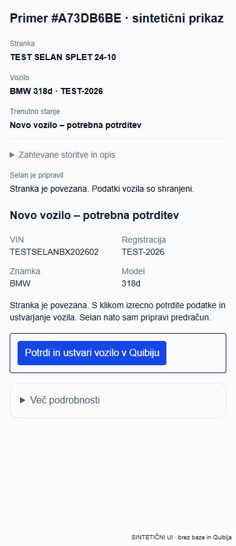
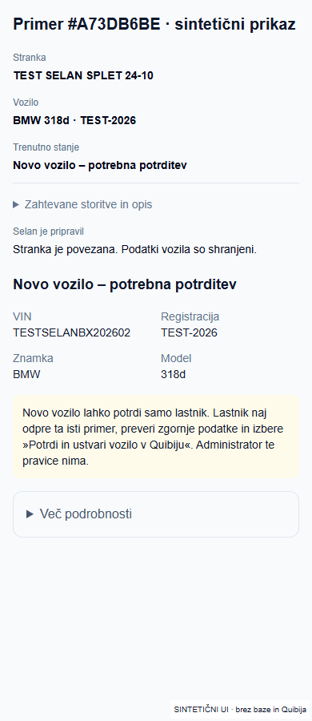

# Administratorska potrditev vozila v gostovanem DEV

Administrator lahko v gostovanem Preview (APP_ENV=preproduction, QUIBI_MODE=dev, VERCEL_ENV=preview) izrecno potrdi novo Quibi vozilo. Produkcijski administrator te nove pravice nima; obstoječa pravica lastnika ostaja. Ni sprememb članstva, RLS, migracij, nastavitev WRITE/SEND ali produkcijske objave.

## Naslednji klik

1. Kot administrator odpri [primer #A73DB6BE](https://selan-dev-pr19-azalar7-langs-projects.vercel.app/dashboard/primeri/a73db6be-7216-4677-bc0a-26e97693ad75).
2. Preveri BMW 318d, TEST-2026, VIN TESTSELANBX202602 in klikni **Potrdi in ustvari vozilo v Quibiju**.
3. Selan ponovno preveri identiteto, podvojitve in dnevnik, poveže preverjen rezultat ter sam nadaljuje trajno pripravo osnutka. Ne zahteva dodatnega sprejema ali sinhronizacije. Po osvežitvi mora ostati ista povezava in shranjen osnutek.

Vsi trije zahtevani opisi ostajajo: servis vozila, pregled pred tehničnim pregledom in pregled zavor. Katalog ne zagotavlja vseh cen: pozitivna cena pri »brezplačnem« pregledu zahteva izbiro; neprepoznana storitev ostane prosta brez izmišljene cene. Nastanek predračuna ni samodejna poslovna odobritev ali CREATE dokumenta.

## Dokazi in omejitve

- 45 ciljnih testov: dovoljenja DEV/prod/lokalno/demo, identiteta, podvojitve, priprava treh storitev in potek.
- 5 dodatnih testov dejanske strežniške akcije z izoliranimi adapterji: DEV admin, zavrnitev prod admin/mehanika/nepotrjenega klika, nespremenjena lastniška pravica, zastarel vnos, neuspešna povezava, samodejni začetek priprave po povezavi. Brez omrežja ali dejanskih CREATE operacij.
- 15 hidriranih UI scenarijev pri 1440/390/350 px; DEV admin in lastnik imata neposreden gumb brez checkboxa; produkcijski admin ostane brez CREATE. 42 dodatnih navigacijskih UI scenarijev uspešnih.
- TypeScript in ciljni ESLint uspešna.
- Dejanska DEV baza: aktivni administrator in lastnik oba uspešno prestaneta obstoječi resolve_case_vehicle/ready. Funkcija in RLS že dovoljujeta aktivno članstvo owner/admin v pravilni organizaciji. Spremembe baze niso potrebne.
- Prijavljeni E2E **ni preverjen**: CUA vrne `failed to write kernel assets`, ločeni Playwright pa preusmeri na /login. Odprta uporabnikova seja ne pomeni, da jo ima testno orodje.
- Vozila ali dokumenta nismo ustvarili. Ni pošiljanja e-pošte. Dejanski uspeh uporabnikovega klika in poznejše shranjevanje v prijavljeni aplikaciji mora potrditi ročni preizkus zgoraj.

## Sintetični posnetki dejanskih komponent

## Prebrane smernice in analiza

- C:/Users/Admin/.codex/worktrees/selan-p0-guided-case/m3-m4-ci-db-tests-v1/AGENTS.md in CLAUDE.md
- C:/Users/Admin/.ai-os/ORCHESTRATION_GUIDE.md
- C:/Users/Admin/.agents/skills/ai-orchestrator/SKILL.md
- C:/Users/Admin/.agents/skills/security-review/SKILL.md
- C:/Users/Admin/.agents/skills/deploy-to-vercel/SKILL.md
- C:/Users/Admin/.codex/plugins/cache/openai-curated-remote/supabase/1.0.0/skills/supabase/SKILL.md
- C:/Users/Admin/.codex/plugins/cache/openai-curated-remote/vercel/0.54.1/skills/deployments-cicd/SKILL.md
- C:/Users/Admin/avtoservis-selan/docs/selan-rea-complete-ux-audit.md
- node_modules/next/dist/docs/01-app/03-api-reference/01-directives/use-server.md v aktivnem worktreeju

REA pregled je delno starejši od PR: aktivni obrazec, zložene podrobnosti in nadaljevanje priprave že obstajajo. Teh rešitev nismo ponovno gradili. Nova sprememba je omejena DEV pravica in njena dosledna uporaba v obeh obstoječih strežniških poteh in UI.

## Dodaten popravek dejanske nadzorne plošče

Uporabnikov posnetek je pokazal napako nalaganja po uspešni prijavi. Vzrok v kodi: poizvedba nad published_fixed_price_cases je zahtevala neobstoječi auto_state; dejanska DEV shema je potrdila, da stolpec obstaja samo na offer_preparations. Odstranjen je samo napačni stolpec, brez migracije ali oslabitve RLS. Regresijski test izvede dejanski loader z adapterjem, ki zavrne napačni stolpec; preveri uspešen rezultat in ohranjeno branje auto_state iz pravilne tabele. Vercel CLI ni vrnil error logov; odsotnost logov ne dokazuje uspešnega prijavljenega zaslona.

## Objavljena različica

- Runtime commit: `54b8e0554c4ea20d185550b54b7041f37818c394` (administratorska pravica `66202b8`, dashboard popravek `54b8e05`).
- Preview READY: `dpl_6mLdD2KZYM12KrKnV4bDo3aRFUnq`, projekt `prj_OSpIMwU9zkrcImKhGxpaq8PnrgUU`, ekipa `team_2OC48hyth331W4Z02Cei2ZTL` / `azalar7-langs-projects`.
- [Stalni DEV](https://selan-dev-pr19-azalar7-langs-projects.vercel.app), [nespremenljiva objava](https://avtoservis-selan-quswwlaic-azalar7-langs-projects.vercel.app).
- Gostovani webpack build in TypeScript uspešna. Predpomnilnik kataloga in že odobrene nastavitve ohranjene; SEND=0, produkcijski WRITE/SEND=0.
- [Sveži dejanski READ dokaz](quibi-dev-read.json): 9 GET, preverjena stranka 405964, brez povezave vozila, brez globalnega VIN/registracijskega ujemanja in brez vehicle CREATE dnevnika; vse tri zahtevane storitve prepoznane. Brez WRITE/SEND.
- Regresijski preizkus nadzorne plošče potrjen tudi RED/GREEN: prvotna napačna poizvedba test podre, popravljena ga opravi. Skupaj 51 ciljnih testov (45 + 5 + 1), 15 hidriranih UI in 42 navigacijskih scenarijev.
- Dodatno prebrani veščini: C:/Users/Admin/.agents/skills/superpowers/systematic-debugging/SKILL.md in C:/Users/Admin/.agents/skills/superpowers/verification-before-completion/SKILL.md; CLI smernice C:/Users/Admin/.codex/plugins/cache/openai-curated-remote/vercel/0.54.1/skills/vercel-cli/SKILL.md.

Administratorski ročni test je pripravljen. Dejanski CREATE in priprava po uporabnikovem kliku v prijavljeni aplikaciji ostajata nepreverjena do njegovega preizkusa. Ne klikajte znova pri neznanem izidu; preverite povezavo in dnevnik.
