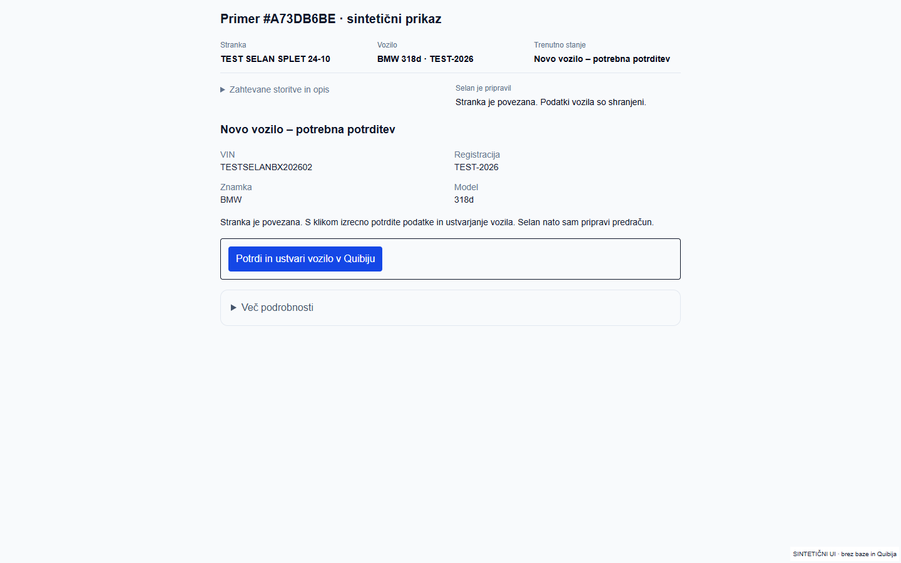

# #A73DB6BE – jasna potrditev novega vozila

## Dejanski vzrok

Stranka TEST SELAN SPLET 24-10 / Quibi #405964 je povezana, BMW 318d / TEST-2026 pa nima Quibi povezave. Prejšnji zaslon je hkrati pokazal tehnično povezovanje, razdelke prihodnjih faz in sprejem z onemogočenim gumbom. Dejanje za ustvarjanje novega vozila je bilo skrito globoko v razreševanju vozila. Administrator ni dobil jasnega navodila za lastnika.

Obstoječe strežniško pravilo `createVehicleForCase` dovoljuje CREATE samo vlogi `owner`; `admin` lahko preverja oziroma potrdi ustrezno obstoječe vozilo, ne ustvarja novega. To pravilo je ohranjeno. Ni sprememb dovoljenj, RLS, okolijskih skrivnosti ali podatkovnih migracij.

## Popravek

Na vrhu so kratki podatki stranke in vozila, stanje in že opravljeno delo. Dejansko trenutno opravilo je neposredno odprto. Ostali podatki, Quibi dokumenti, zgodovina in diagnostika so pod enim razdelkom **Več podrobnosti**. Termini, nalog, dodelitev in zaključek se vključijo, ko to upravičuje trenutna faza ali že obstoječi podatki. Obstoječe alternative, tudi objavljena cena v prvotni dovoljeni fazi, so ohranjene.

Če stranka obstaja in vozilo še ni povezano:

- **Administrator:** vidi »Novo vozilo – potrebna potrditev«, podatke vozila in navodilo, naj isti primer odpre lastnik. Nima onemogočenega CREATE gumba ali obrazca za prezgodnji sprejem.
- **Lastnik:** pregleda VIN, registracijo, znamko in model ter klikne **Potrdi in ustvari vozilo v Quibiju**. Klik je izrecna poslovna potrditev; dodatno enako potrditveno polje ni potrebno. Strežnik še vedno preveri dejansko lastniško vlogo, identiteto stranke, spremembo podatkov, morebitne dokumente, globalne podvojitve VIN/registracije in CREATE dnevnik. Neznanega ali že preverjenega poskusa ne pošlje ponovno.
- **Po povezavi:** isto dejanje sproži obstoječo strežniško pripravo. Selan pripravi storitve in preverjene cene, shrani osnutek ter sam pokaže naslednjo odločitev. Osveževanje zajame tudi prehod iz starega neuspelega stanja po pravkar potrjenem vozilu.

Dejanski spletni opis vsebuje dobesedne `\\n`. Razčlenjevanje zdaj prepozna vse tri storitve in izpusti izrecno TESTNO glavo; ne ustvari ene dolge postavke iz celotnega testnega sporočila. Neznanih cen ne izmišlja.

Na nadzorni plošči je en iskalnik in ena vrsta brez lastnega navpičnega drsenja. Podvojeni drugi seznam primerov je odstranjen; vsi primeri ostajajo dostopni v štirih obstoječih skupinah. Podvojena vrstica v podatkovnem posnetku se združi po ID-ju primera. TEST/QA-SIM so še vedno ločeni. Naslednja dejanja so kratka in ohranijo konkretno odločitev pri samodejnem osnutku.

## Preverjanje

- Dejanski Supabase READ potrdi povezano stranko, manjkajočo povezavo vozila in samo preverjen CREATE stranke. CREATE vozila v dnevniku ni.
- Gostovani READ v Quibi DEV potrdi identiteto #405964, nič vozil stranke, nič globalnih ujemanj VIN/registracije in prazen dnevnik vozila. Prepoznane so vse tri zahtevane storitve. Skripta `quibi-case-a73-read.mjs` zavrne vse metode razen GET. [Dejanski rezultat](quibi-dev-read.json).
- 52 ciljnih testov: lastniško naslednje opravilo, razpoznavanje dejanskega spletnega opisa, enolična vrsta ter obstoječa zaščita pred podvojenim/negotovim CREATE vozila.
- 42 prikaznih/navigacijskih scenarijev pri 1440/390/350 px: trenutno opravilo je prvo, obrazci se ne podvajajo, tipkovnica in povezave v skrite podrobnosti delujejo, ni prelivanja.
- 12 hidriranih scenarijev pri 1440/390/350 px: administrator nima CREATE gumba, lastnik ima eno izrecno dejanje, potrditvena vrednost in ID primera sta vezana na klik; skrite podrobnosti se ne prikazujejo. Nadzorna plošča ima en iskalnik, eno vrstico ob podvojenem vhodu in nobenega notranjega drsenja vrste. Preverjen je tudi nespremenjeni mehanikov prikaz.
- TypeScript in ESLint uspešna. Gostovani build preveri še končni runtime.

**Prijavljeni E2E ni potrjen.** Orodje ne more odpreti prijavljene IAB seje (`failed to write kernel assets ... os error 3`); ločeni brskalnik nima seje. Zato dejanski lastnikov CREATE vozila, povezava in samodejna priprava na tem primeru niso označeni kot izvedeni. Ne ustvarjamo vozila v imenu lastnika samo zaradi posnetka. Osnutek in njegovo shranjevanje po potrjeni povezavi sta bila prej preverjena na ločenem sintetičnem primeru; to ni dokaz lastnikovega klika na #A73DB6BE.

## Kratek dejanski preizkus za lastnika

1. [Odpri isti primer](https://selan-dev-pr19-azalar7-langs-projects.vercel.app/dashboard/primeri/a73db6be-7216-4677-bc0a-26e97693ad75) kot lastnik.
2. Preveri BMW 318d, TEST-2026 in VIN TESTSELANBX202602. Če podatki držijo, izberi **Potrdi in ustvari vozilo v Quibiju**. Če se podatki medtem spremenijo ali obstaja rezultat, najprej osveži in preveri isti primer; ne ustvarjaj drugega vozila.
3. Ne zaganjaj sinhronizacije ali priprave posebej. Počakaj na shranjen osnutek; osveži in preveri ohranjene podatke. Razreši samo morebitno nejasno storitev oziroma manjkajočo ceno. Predračuna ali drugih dokumentov za ta preizkus ni treba ustvarjati ali pošiljati.

Spodnji posnetki so **dejanski posnetki izoliranih resničnih komponent** s sintetičnimi podatki tega primera. Niso posnetki prijavljene aplikacije in ne dokazujejo Quibi CREATE.

[Administrator 350 px](../selan-redesign/vehicle-admin-350.png) · [Lastnik 350 px](../selan-redesign/vehicle-owner-350.png) · [Nadzorna plošča 1440 px](../selan-redesign/dashboard-1440.png) · [Rezultati komponent](../selan-redesign/shell-browser-results.json)

## Datoteke in smernice

Spremenjene so obstoječe komponente `CaseWorkspace`, `CaseOverview`, `CaseJourney`, `VehicleResolutionPanel`, `VehicleResolutionForm`, `ReviewIntakeButton`, `DashboardPageClient`, stran primera in naslednja dejanja. `NewVehicleDecision` je majhen skupni prikaz za preverjanje obeh vlog. Obstoječi `vehicle-resolution-actions.ts` po uspehu sproži isti `scheduleIntakeSynchronization`; obstoječe varovalke CREATE ostanejo.

Prebrano/uporabljeno: `C:/Users/Admin/.codex/worktrees/selan-p0-guided-case/m3-m4-ci-db-tests-v1/AGENTS.md`, `CLAUDE.md`, `C:/Users/Admin/.ai-os/ORCHESTRATION_GUIDE.md`, `C:/Users/Admin/.agents/skills/ai-orchestrator/SKILL.md`, `C:/Users/Admin/.agents/skills/security-review/SKILL.md`, `C:/Users/Admin/.codex/plugins/cache/openai-curated-remote/supabase/1.0.0/skills/supabase/SKILL.md` in lokalna dokumentacija Next `node_modules/next/dist/docs/01-app/03-api-reference/04-functions/after.md`. Uporabljena so obstoječa pravila za Supabase dostop in preverjanje identitete; ni novih odvisnosti ali pravic.

## Končna objava

[DEV aplikacija – isti primer](https://selan-dev-pr19-azalar7-langs-projects.vercel.app/dashboard/primeri/a73db6be-7216-4677-bc0a-26e97693ad75), runtime commit `f301befe141fde47455831778233364e3588bd0c`, deployment `dpl_78GPpLzDcAaxbRSCtDg4uRf7Zfhd`, READY. Projekt `avtoservis-selan-dev` / `prj_OSpIMwU9zkrcImKhGxpaq8PnrgUU`, ekipa `azalar7-langs-projects`. [Nespremenljivi Preview](https://avtoservis-selan-da7jxsvt8-azalar7-langs-projects.vercel.app).

Končni gostovani build in TypeScript uspešna. Ponovljeno dejansko preverjanje je uporabilo devet GET klicev, potrdilo prazno povezavo/dnevnik vozila in nič globalnih podvojitev. V tem nadaljevanju ni bilo Quibi CREATE, pošiljanja, podatkovnih zapisov na primeru, sprememb pravic, migracij ali produkcije. Kasnejši commit vsebuje samo dokumentacijo in dokazila. PR #19 ostaja Draft.
