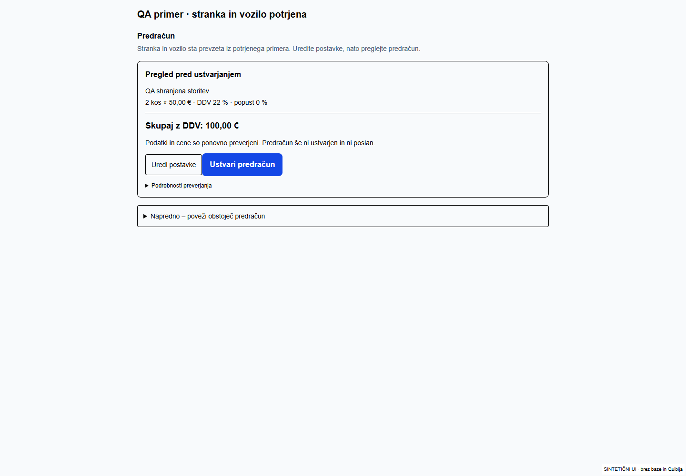
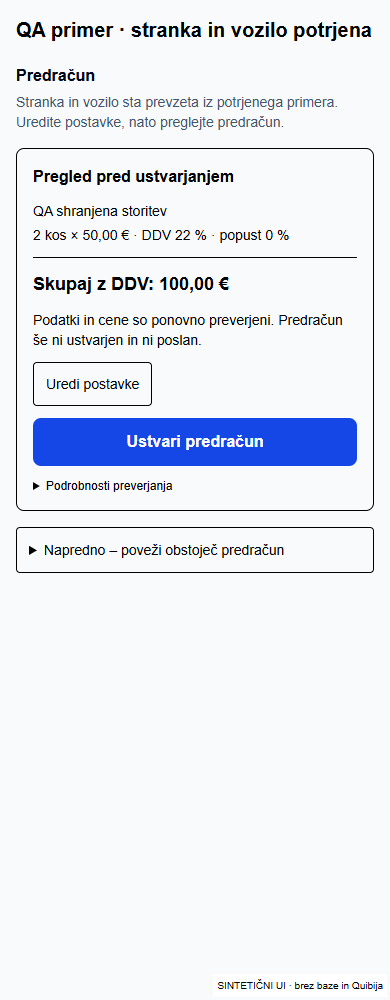

# Samodejna priprava po vnosu – 24. 10. 2026

Ročni in spletni vnos že kličeta isto obdelavo `processIntakeSynchronization`. Ta zdaj po preverjeni povezavi stranke in vozila sestavi ter trajno shrani osnutek na obstoječi vrstici `offer_preparations`. Ne čaka na odprtje urejevalnika in ne ustvari Quibi dokumenta.

## Kaj je spremenjeno

- Po uspešnem vnosu se strežniški `after()` nadaljuje neodvisno od odprtega obrazca. Uporabi obstoječo sinhronizacijo, predpomnjeni katalog, razpoznavo vseh zahtevanih storitev, potrjene nastavitve ter sveže preverjanje izbranih cen, enot, DDV in cenika stranke.
- Osnutek, stanje, vhodni podatki in identifikator izvajanja so shranjeni v obstoječi pripravi. Zaklep prepreči dvojni prevzem. Rezultat starega izvajalca ali spremenjenega vhoda se zavrne. Ista priprava ne podvaja strank, vozil ali dokumentov.
- Odprta stran med pripravo sama preverja shranjeni rezultat. Na naslednji prijavljeni zahtevi se samodejno nadaljujejo tudi prekinjena opravila, katerih petminutni prevzem je potekel; napake imajo minutni odmik. To ni neomejen zunanji izvajalnik: če proces odpove in ni več nobene zahteve v aplikacijo, ponovni zagon počaka na naslednji obisk. Običajen odhod uporabnika s strani ne prekine `after()`.
- Shranjeni osnutek se uporabi po osvežitvi. Popravki vrstic se shranijo ob zapustitvi polja in pred pregledom. Sočasni zastareli prepis se zavrne; uporabnik dobi opozorilo, vnosi ostanejo na zaslonu. Ob napaki shranjevanja ne zapustite strani, dokler ne preverite izida.
- Ločen sprejem z dodatnim potrditvenim poljem ni potreben za samodejno pripravljeni osnutek. Obstoječi strežniški sprejem se izvede ob Tadejevem kliku za pregled predračuna. To ne potrdi strankine odobritve in ne ustvari dokumenta.
- Naslednje dejanje uporablja shranjeno stanje: pripravljanje, pregled, izbira storitve ali manjkajoča cena. Nadzorna plošča dobi obvestilo prek obstoječe objave `service_requests`; nove Realtime objave ni. Brskalniški prenos med prijavljenima sejama ni potrjen.
- Obstoječi CREATE ostaja po izrecni potrditvi popolnega in sveže preverjenega pregleda ter z obstoječim dnevnikom za enkratni zapis. Nalog se pripravlja iz dejansko odobrenega predračuna, račun šele po dejanskem zaključku in obstoječem pregledu vodje. Odobritev, delo, plačilo ali pošiljanje se ne izmišljajo.

## Preverjanje po plasteh

| Preizkus | Rezultat in meja dokaza |
| --- | --- |
| Skupna priprava A/ročno in B/splet, trije popolni sintetični katalog vnosi | Isti osnutek s tremi vrsticami, preverjene cene/enote/DDV; izoliran test resnične funkcije, ne prijavljeni E2E. |
| Resnični ročni RPC s povezano obstoječo sintetično stranko in vozilom | Primer `564fb87d-1915-4bd6-b549-5722e2f30f1b`, stranka in vozilo nista ponovno ustvarjena. Gostovani izvajalnik je shranil tri vrstice, stanje `ambiguous`; redni servis 32,94 EUR. Dva sočasna klica in ponovitev ohranijo isti osnutek. |
| Dejanski enaki A/B RPC vnosi z namerno neujemajočimi se sintetičnimi kontakti | Ročno `c302f243-4d04-40e1-97e0-08db8b9a27da`, splet `ef314cdf-5e88-4d7e-83ec-2befec9bbbe4`. Oba RPC uspešna, uporabljata isto novo lokalno sintetično stranko in vozilo. Ime se namenoma ujema z obstoječo Quibi TEST stranko, kontakti pa ne. Pričakovan izid je pregled identitete brez ugibanja povezave ali Quibi CREATE. Končni gostovani rezultat je v JSON dokazilu. To ni pozitiven spletni E2E do predračuna. |
| SQL varovalke na DEV | Prevzem in zavrnitev dvojnega prevzema; zavrnitev rezultata po spremembi vhoda; pooblaščeno shranjevanje in zavrnitev zastarelega prepisa. Spremembe teh testov so zavrnjene z ROLLBACK. Anon nima pravice izvajati opravil ali shranjevanja; običajni uporabnik nima pravice izvajati strežniškega opravila. |
| Mobilni in namizni prikaz | 1440, 390, 350 px. Isti pregled za A/B, shranjene začetne vrstice po reloadu, shranjevalni klic in ponovno branje urejenih vrstic v fixture, brez ponovne potrditve in brez prelivanja. Resnične hidrirane komponente z izoliranimi akcijami; niso prijavljena aplikacija ali dejanski CREATE. |
| Regresije | 98 ciljnih testov uspešnih: priprava, identiteta, vrstične cene, potek primera, nadzorna plošča, pogodbe CREATE in obstoječi delovni nalog/račun. TypeScript in ESLint uspešna. |

Testna skripta `scripts/automatic-draft-smoke.mjs` uporablja obstoječe skrivnosti izključno v gostovanem DEV izvajalniku. Transport Quibi dovoljuje samo GET. Primeri se preverijo pred obdelavo, nobena skrivnost ni zapisana lokalno. Shim za Next cache/revalidate je omejen na samostojni test izvajalnika; poslovna funkcija, Quibi READ, RPC prevzem in shranjevanje so resnični. Runtime aplikacija uporablja pravi Next cache in revalidate.

Tri aditivne migracije so uporabljene samo na obstoječem Preview Supabase projektu `verxxsjbewmkgoxwqvxo`; povezava je potrjena prek nastavitve `NEXT_PUBLIC_SUPABASE_URL` projekta `avtoservis-selan-dev`. Obstoječe RLS politike niso spremenjene. Produkcijska povezava ni konfigurirana v tem Vercel projektu in produkcija ni uporabljena.

## Kaj še zahteva odločitev

- Pozitivna cena pri nazivu »BREZPLAČNI PREGLED …«: uporabnik mora izbrati pravilno možnost; aplikacija ne domneva ničelne cene ali samodejnega zaračunavanja.
- Pregled zavor nima zanesljivega artikla: prosta vrstica ostane brez cene. Nabor 200 nezalogovnih artiklov ni dokaz, da so vsi servisne storitve ali da zajemajo vse posege.
- Nejasna stranka, vozilo oziroma novo vozilo brez izrecne potrditve lastnika se ustavi za pregled. Obstoječe pravilo, ki prepoveduje samodejni CREATE novega vozila, ostaja.
- Strankino odobritev, zaključek dejanskega dela in poslovno potrditev dokumentov še vedno opravi pooblaščeni uporabnik. DEV pošiljanje e-pošte ostaja izključeno.

## Prijavljeni E2E in kratek ročni preizkus

**Prijavljeni E2E ni potrjen.** Ponovni poskus dostopa do obstoječe prijavljene IAB seje je vrnil `failed to write kernel assets: ... os error 3`. Ločeni Playwright nima uporabnikove seje. Pozitiven spletni potek do predračuna je potrjen v izolirani skupni funkciji, ne skozi dejanski prijavljeni UI. Obstoječa povezana sintetična stranka za pozitiven DEV test nima telefona, ki ga javni spletni obrazec zahteva; tega podatka ne izmišljamo ali spreminjamo samo za uspešen test.

1. Na DEV vnesi sintetično povpraševanje s preverjeno stranko in vozilom ter tremi storitvami. Enak veljaven spletni vnos naj uporablja oba zahtevana kontakta.
2. Po shranitvi ne sprožaj povezovanja ali priprave. Počakaj na shranjeni rezultat; lahko odpreš drugo stran in se vrneš.
3. Pri predračunu preveri vse tri vrstice. Razreši samo nejasno storitev oziroma manjkajočo ceno.
4. Spremeni količino ali izrecno dogovorjeno testno ceno, zapusti polje in osveži stran. Vrednost mora ostati shranjena; zastarelo odprto drugo okno ne sme tiho prepisati novejših podatkov.
5. Izberi Preglej predračun. Ne sme zahtevati dodatnega potrditvenega polja za isti sprejem. V tem preverjanju ni treba ustvarjati novega Quibi dokumenta.

## Datoteke in uporabljene smernice

Spremembe: `automatic-intake-sync.ts`, nova skupna sestava in shranjevanje `automatic-estimate-draft.ts` / `automatic-draft-actions.ts`, obstoječi urejevalnik `EstimateComposer.tsx`, stran primera, naslednje dejanje in branje nadzorne plošče; tri aditivne migracije `20261024094647`, `20261024100001`, `20261024100417` (kanonične verzije DEV; preslikava v `supabase/migration-version-map.json`). Katalog in videz nista ponovno implementirana, novih odvisnosti ni.

Prebrano:

- `C:/Users/Admin/.codex/worktrees/selan-p0-guided-case/m3-m4-ci-db-tests-v1/AGENTS.md` in `CLAUDE.md`.
- `C:/Users/Admin/.ai-os/ORCHESTRATION_GUIDE.md`.
- `C:/Users/Admin/.agents/skills/ai-orchestrator/SKILL.md` (uporabljen dispatcher).
- `C:/Users/Admin/.agents/skills/security-review/SKILL.md` (uporabljen za vnos in strežniško shranjevanje).
- `C:/Users/Admin/.codex/plugins/cache/openai-curated-remote/supabase/1.0.0/skills/supabase/SKILL.md` (uporabljen za preverjanje DEV sheme, varovalke in migracije).
- `C:/Users/Admin/.agents/skills/supabase-postgres-best-practices/SKILL.md`.
- `C:/Users/Admin/.agents/skills/superpowers/systematic-debugging/SKILL.md` in `verification-before-completion/SKILL.md` (vzrok in sveži dokazi).
- `C:/Users/Admin/.agents/skills/superpowers/brainstorming/SKILL.md` in `test-driven-development/SKILL.md`; uporabnik je že določil želeni postopek in izrecno zahteval implementacijo brez novega načrtovanja.
- `node_modules/next/dist/docs/01-app/03-api-reference/04-functions/after.md`.
- Aktualni Supabase changelog `https://supabase.com/changelog.md` (ni relevantne spremembe za uporabljeni PostgREST RPC API).

Commit/push: izveden samo na obstoječi veji PR #19. Merge in produkcijska objava nista izvedena.

[Dejanski rezultat gostovanega izvajalnika](quibi-dev-worker.json): oba A/B negativna primera sta potrjeno shranjena kot `blocked`; povezana sintetična stranka ima osnutek s tremi vrsticami in stanje `ambiguous`. Pozitivni primer zahteva samo izbiro predtehničnega pregleda ter manjkajočo ceno pregleda zavor. Osvežitev ne povrne izvirnega opisa čez Tadejev shranjeni popravek; dodan regresijski brskalniški test je najprej dokazal napako in nato uspešno prestal pri vseh treh širinah.

## Končni DEV Preview

[Odpri aplikacijo](https://selan-dev-pr19-azalar7-langs-projects.vercel.app/dashboard). Runtime commit `b3c90b29769311de2e1292bce99b7161d7d02ba6`, deployment `dpl_APFSzSa17nukyaZjVEfgfAa5mJU3`, READY. Projekt `avtoservis-selan-dev` / `prj_OSpIMwU9zkrcImKhGxpaq8PnrgUU`, ekipa `azalar7-langs-projects`. [Nespremenljiva različica](https://avtoservis-selan-fejmkhfcs-azalar7-langs-projects.vercel.app).

Končni gostovani Next build in TypeScript uspešna. Izvajalnik je ponovno prebral shranjeni osnutek, preveril idempotentno ponovitev in oba negativna A/B izida. Quibi je prejel samo tri GET klice v tem ponovljenem preizkusu; polno branje kataloga za prvotno pripravo je bilo potrjeno v prejšnji gradnji. Ni novih dokumentov ali pošiljanja. Kasnejši commit vsebuje samo dokazila in navodila.
