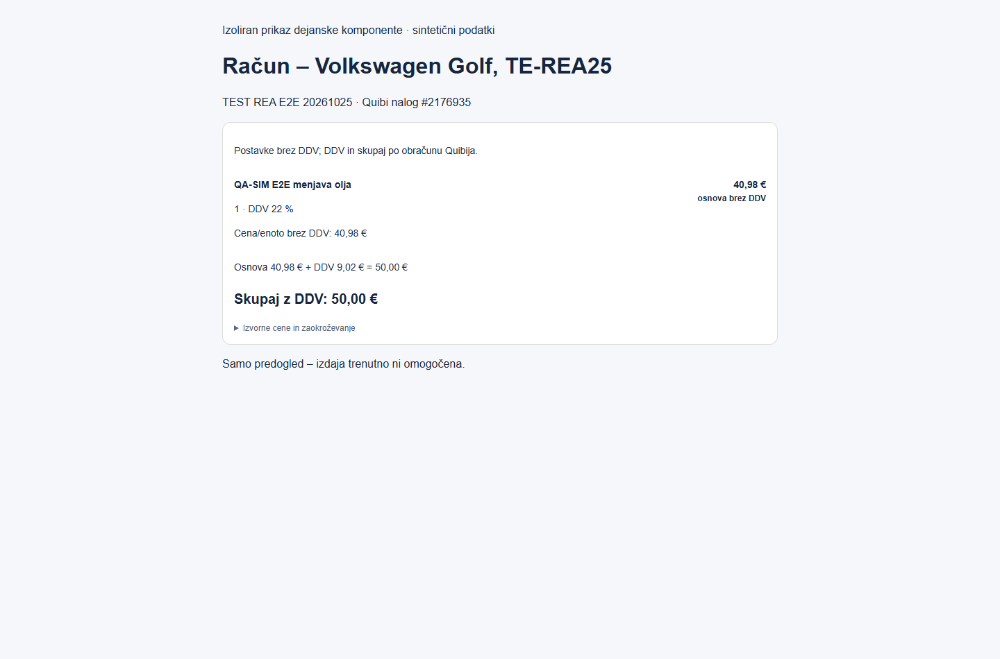

# Račun brez dodatnega pregleda in kanonične Quibi cene

## Dejanski DEV READ (25. 10. 2026)

Samo GET obstoječih dokumentov 2176934 in 2176935 ter sintetične stranke 405965. Nobenega Quibi CREATE/UPDATE/SEND; brez sprememb podatkov primera C066482D, vozila ali dovoljenj.

Oba dokumenta vrneta glavo 50.00 EUR, neto/enoto in neto postavko 40.97540984, količino 1, popust 0 in DDV 22 %. Davčni povzetek vsebuje osnovo 40.98000000, DDV 9.01560000 in skupaj 49.99560000. Stranka ima dniZapadlosti=5; datum storitve in zapadlost na izvornih dokumentih nista posredovana.

Vzrok: prejšnji UI je prikazoval izpeljano bruto enoto iz surove neto cene (49.99), glava pa sledi Quibijevemu obračunu zaokrožene neto osnove. Dokumentov nismo spreminjali.

## Pravilo prikaza

Postavke so jasno označene BREZ DDV. Za vrstico uporabimo preverjeno izvorno neto vrednost oziroma decimalni izračun količina × neto enota × (1 − popust). DDV in skupni znesek izhajata iz Quibijevega davčnega povzetka in glave. Denarne vrednosti prikažemo z decimalnim zaokroževanjem half-up na cent; ne množimo prikazane zaokrožene bruto enote nazaj v vrstico. Ne dodajamo izmišljene postavke ali razdeljujemo centov med postavke.

Za ta primer: **40,98 € + 9,02 € = 50,00 €**. Izpeljana bruto enota ostane samo v zloženih izvornih podatkih. Isti komponentni prikaz uporablja priprava računa, pregled predračuna in branje Quibi dokumentov. Strežniška kontrola dopušča samo preverjene izračune bruto vrstic ali neto osnov in DDV, brez poljubne centne tolerance.

Dokumentacija: https://navodila.quibi.net/za-razvijalce/ (polje cenaZDDV pri prostih postavkah kljub imenu pomeni neto ceno; dniZapadlosti je plačilni rok stranke).

## Potek in datumi

Po potrditvi vodje obstoječi obrazec samodejno prebere in preveri podlago. Vmesnega gumba »Preglej račun« ni več. Samo veljaven preverjeni predogled in omogočen WRITE ponudita izrecni »Izdaj račun«. Brez WRITE ostane kratka informacija. Ob spremembi polja se SHA razveljavi in izvede nova priprava; dejanska izdaja ponovno preveri vir in dnevnik podvojitev.

Datum storitve izpolnimo samo iz izrecnega izvornega podatka; datum izdaje iz trenutnega dne Europe/Ljubljana; zapadlost iz preverjenega plačilnega roka ali že vnesene vrednosti. Pri tem primeru manjka datum storitve in ga mora uporabnik vnesti. Za izdajo 25. 10. 2026 petdnevni rok pomeni 30. 10. 2026. Shranjene oziroma med READ ročno popravljene vrednosti se ne prepišejo. Datumi ostanejo ISO, prikaz je dd. mm. llll.

## Dokazi in omejitve

- Celoten lokalni nabor pred zadnjo regresijo obstojnosti: 660/660 PASS; dodatna regresija obstojnosti datumov 1/1 PASS. Končni celoten rezultat preveri CI istega PR.
- TypeScript in ESLint preverjena brez napak; produkcijski build se preveri v Code checks in Preview deploymentu.
- Regresije: samodejni READ, odsotnost review gumba, en izrecni gumb izdaje, WRITE off, podvojeni računi, količine, popusti, več stopenj DDV, centno zaokroževanje, znani/manjkajoči datumi, obstojnost in zaščita ročnega vnosa.
- Izolirana dejanska komponenta izrisana v Edge pri 1440/390/350 px, brez vodoravnega prelivanja. Posnetki uporabljajo sintetične podatke in minimalni QA CSS, niso dokaz prijavljene gostovane strani.
- Prijavljeni gostovani E2E v tem preverjanju NI potrjen; razpoložljiva seja je na prijavi. Obstoječa dokumenta sta bila dejansko preverjena z varnim strežniškim READ na istem DEV projektu. Nobene izdaje ali pošiljanja.

## Prebrana pravila in uporabljene veščine

- Aktivni worktree: C:/Users/Admin/.codex/worktrees/selan-p0-guided-case/m3-m4-ci-db-tests-v1; AGENTS.md in CLAUDE.md.
- C:/Users/Admin/.ai-os/ORCHESTRATION_GUIDE.md
- C:/Users/Admin/.agents/skills/ai-orchestrator/SKILL.md
- C:/Users/Admin/.agents/skills/superpowers/systematic-debugging/SKILL.md
- C:/Users/Admin/.agents/skills/superpowers/verification-before-completion/SKILL.md
- C:/Users/Admin/.agents/skills/security-review/SKILL.md
- C:/Users/Admin/.agents/skills/deploy-to-vercel/SKILL.md
- C:/Users/Admin/.agents/skills/vercel-react-best-practices/SKILL.md
- C:/Users/Admin/.codex/plugins/cache/openai-curated-remote/supabase/1.0.0/skills/supabase/SKILL.md
- node_modules/next/dist/docs/01-app/03-api-reference/01-directives/use-client.md
