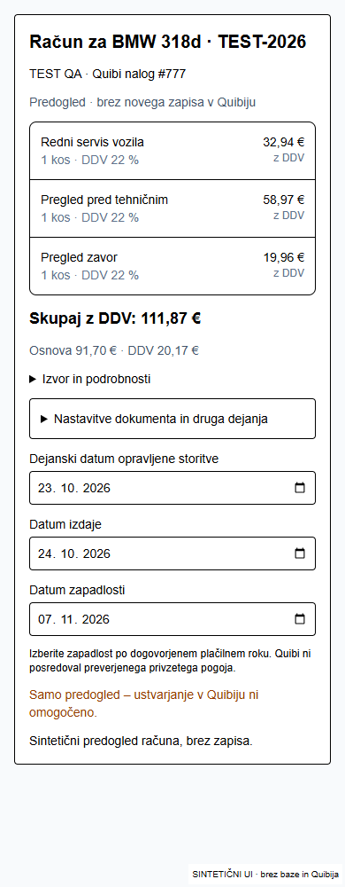
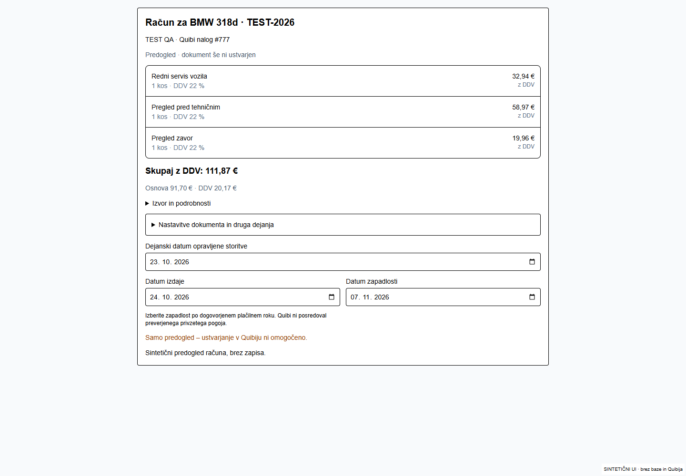

# P1: povezan vsakodnevni postopek

## Implementirano v istem PR #19

- Nadzorna plošča uporablja sedem skupin: novo; priprava/odobritev; popravilo; pregled vodje; račun; prevzem/plačilo; zaključeno. To je prikaz obstoječih stanj, ne nov poslovni model. Sintetični primeri so še vedno ločeni in primeri deduplicirani. Ime mehanika se prenaša iz istega RLS branja ekipe; kadar manjka, je nadomestilo e-pošta. Pravice urejanja imen ostajajo nespremenjene.
- Račun takoj pokaže stranko, vozilo, izvorni nalog, tri pripravljene postavke, količino/enoto, DDV, obračunsko vrednost in skupni znesek. Izvor in tehnične nastavitve so zloženi. Potrjen pregled vodje odstrani ponavljajoče potrditveno polje zaključka; CREATE še vedno sveže preveri stanje, pregled, identiteto, SHA, cene, Quibi vire in dnevnik.
- Onemogočeni CREATE nima gumba, ki obljublja izdajo. Onemogočeni SEND brez obstoječega poskusa pokaže samo kratek status. Obstoječi poskus še omogoča READ preverjanje statusa; pošiljanje se ne ponavlja.
- Zapadlost ni več samodejno datum izdaje. Uporabnik izbere dogovorjeni datum; strežnik brez njega ne pripravi SHA za izdajo in ne pošlje CREATE. Preverjenega privzetega plačilnega roka v trenutnih integracijskih podatkih nimamo, zato ga ne izmišljamo.
- Trije datumi se ohranijo po osvežitvi v isti brskalniški seji, ločeno za primer/stranko. Shrani se samo datum, ne podatki dokumenta ali skrivnosti. To ni strežniško shranjen osnutek in ne zagotavlja prenosa datumov na drug telefon ali po koncu seje.
- Zaključenemu, še nezaklenjenemu delu je mogoče dodati naknadni zapis pod zloženo možnostjo. To ni obrazec ponovnega zaključevanja; dopolnitev dokazil razveljavi stari pregled in zahteva nov pregled trenutnih dokazil. Zaklenjen primer ostane samo za branje.
- Fotografija ne zahteva ročno vnesenega opisa: uporabi nevtralno oznako »Fotografija popravila«. Zasebna shramba, validacija datoteke, večkratni izbor in predogled so ohranjeni.
- Pregled vodje kratko pokaže znani odprti znesek ob preverjanju oziroma jasno neznano plačilo. Prevzem ostaja ločeno izrecno dejanje. Plačil se v tej nalogi ne vpisuje ali spreminja v Quibiju.

## Funkcionalni pregled 14 korakov

| Korak | Obstoječa izvedba / preverjanje | Meja |
|---|---|---|
| Spletni in ročni vnos | Skupna strežniška intake sinhronizacija in avtomatska priprava; enotni testi | Prijavljeni E2E ni potrjen |
| Obvezni podatki in identiteta | Zahtevani podatki, Quibi povezave/fingerprint, eksplicitna potrditev novega vozila | Novo vozilo ni ustvarjeno v tej nalogi |
| Quibi prenos | Obstoječe varovalke in dnevnik, zaščita pred ponovitvijo | WRITE konfiguracija nespremenjena |
| Predračun | Katalog, zanesljiva ujemanja, proste postavke, osnutek in pregled | Neznane cene zahtevajo poslovno odločitev |
| Odobritev | Ločena resnična odločitev oziroma označena DEV QA simulacija | Odobritve ne izmišljamo |
| Dodelitev | Obstoječa RPC, preverjeni nalog in aktivni mehanik | Vloge ohranjene |
| Dokazila | Opombe z avtorjem/časom, zasebne fotografije | Brskalniški test uporablja adapter |
| Zaključek mehanika | `work_completed` | Ne pomeni pregleda, izdaje ali plačila |
| Vodja in vračilo | Pregled trenutnega SHA dokazil, vračilo z razlogom v zapisih | Testi dejanskih server actions z izoliranimi adapterji |
| Priprava računa | Svež Quibi nalog, DDV, datumi, cena, predogled | CREATE je ločen klik in odvisen od konfiguracije |
| Obstoječi račun / PDF | Povezava in read-only pregled; zaščita pred podvojitvijo | Zgodovinskih dokumentov ne spreminjamo |
| Izdaja / pošiljanje | Obstoječa eksplicitna dejanja in dnevnik | DEV e-pošta ni dokaz dostave; brez novega pošiljanja |
| Prevzem | Ločeno evidentiranje prevzema, po pregledu računa | QA prevzem ni dokaz resničnega prevzema |
| Plačilo / zaključek | READ Quibi plačil, odprti znesek oziroma neznano; dogovor pri zaključku | Plačilo se uredi v Quibiju; prevzem ne pomeni plačila |

Predhodni pregled za odločitev o popravilu ostaja brezplačen ob naročenem popravilu, sicer je obračun ločena pot. Pregled pred tehničnim ni ista storitev. MyPlanly ostaja ročen.

## Preverjanje

477 testov Quibi, dashboarda, primerov, dela in ekipe: uspešno. Popravljeni so bili tudi stari VM adapterji (manjkajoči dejanski helper za decimalne cene, pregled, dovoljenja in povezava na že obstoječi kanonični urejevalnik); varnostnih pravil zaradi testov nismo sproščali.

Brskalniški realni komponentni prikazi pri 1440/390/350 px vključujejo pripravo računa, prazno začetno zapadlost, ohranitev treh datumov po reload, brez ponovnega potrditvenega polja za pregledano delo, brez gumba CREATE pri izključeni pravici in ohranitev ročnih cen 32,94 + 59,00 + 20,00 = 111,94. Poleg tega dashboard/mehanik/pregled/vozilo in dve fotografiji. Noben adapter ni pravi Supabase/Quibi zapis.

Prijavljeni E2E ni potrjen: CUA javlja `failed to write kernel assets`, ločeni Playwright nima uporabnikove prijave. Cursorjeva REA/Chrome seja ni samodejno dostopna Codexu.

## Natančna pot za REA v Cursorju

1. Uporabi prijavljeno odobreno DEV testno organizacijo. Zapiši URL, vlogo in commit; ne kopiraj sej ali gesel.
2. Na A73DB6BE opravi samo READ: BMW 318d / TEST-2026, stranka TEST SELAN SPLET 24-10, nalog 2176933, dva zapiska, fotografija, potrjen pregled. Preveri nove skupine in ime mehanika.
3. Klikni »Pripravi račun«. Preveri tri postavke, bruto cene, DDV, skupaj, datum storitve/izdaje/zapadlosti. Ne ustvarjaj drugega dokumenta, če dnevnik že vsebuje ID ali negotov poskus. A73 in zgodovinskih cen ne popravljaj.
4. Izberi datum zapadlosti drugačen od izdaje, osveži isto sejo in ponovno odpri primer. Preveri ohranitev. Na drugem telefonu ne pričakuj strežniško shranjenih datumov.
5. Pri izključenem CREATE/SEND preveri odsotnost obljubljajočih neaktivnih obrazcev. Pri obstoječem poskusu pošiljanja preveri samo READ status.
6. Za celoten vnos uporabi nov, izrecno sintetični primer: enkrat ročni in enkrat spletni. Počakaj na strežniško pripravo, navigiraj drugam, osveži in preveri shranjeni osnutek. Zabeleži mrežne napake, ne ugibaj uspeha.
7. Če so testne operacije dovoljene, na ločenem sintetičnem nalogu preveri dodelitev, mehanikovo opombo in dve fotografiji, drugo prijavljeno sejo za Realtime, vračilo z razlogom, ponovni zaključek in pregled. Pred vsakim Quibi CREATE preveri obstoječi dnevnik; ne pošiljaj e-pošte.
8. Preveri mobilni prikaz 390/350 in namizni 1440, reload in povratek. Za dokument, prevzem ali plačilo poročaj samo dejansko shranjene/vrnjene rezultate. Ne označi simuliranega popravila ali plačila kot resničnega.

## Navodila / veščine in obseg datotek

Prebrani projektni `AGENTS.md` in `CLAUDE.md`: `C:/Users/Admin/.codex/worktrees/selan-p0-guided-case/m3-m4-ci-db-tests-v1/`.
`C:/Users/Admin/.ai-os/ORCHESTRATION_GUIDE.md`; veščine pod `C:/Users/Admin/.agents/skills/`: `ai-orchestrator/SKILL.md`, `product-designer/SKILL.md`, `security-review/SKILL.md`, `superpowers/verification-before-completion/SKILL.md`, `deploy-to-vercel/SKILL.md`. Vercel `C:/Users/Admin/.codex/plugins/cache/openai-curated-remote/vercel/0.54.1/skills/deployments-cicd/SKILL.md`. Lokalne Next smernice `node_modules/next/dist/docs/01-app/03-api-reference/01-directives/use-client.md` in `use-server.md`.

Spremembe so v obstoječih dashboard adapterjih/skupinah, poslovnem obrazcu, prikazu SEND, fotografijah, pregledu plačila in ciljanih testih. Nov helper hrani samo datume seje. Brez migracij, auth/RLS sprememb ali novih odvisnosti.

Končni commit, status builda, povezava na Preview in rezultat svežega READ preverjanja so navedeni v opisu [PR #19](https://github.com/as-selan/Avtoservis-Selan/pull/19). Skript `scripts/quibi-p1-read.mjs` omeji omrežje na Quibi DEV in ta Supabase DEV; dopušča GET in samo dokumentirani PDF READ POST, nikoli CREATE/UPDATE/SEND. Lokalni TypeScript, ESLint ter 5 dodatnih testov Realtime schedulerja so prav tako uspešni.

## Sveže potrjeno v Quibi DEV (READ, commit f14026f)

[Celoten omejeni dokaz](quibi-read.json): 5 GET in 2 dokumentirana PDF READ POST; `write:false`, `send:false`.

- A73 je `work_completed` in povezan z nalogom **2176933 / 272/2026**. Selanov dnevnik vsebuje preverjeni nalog, ne povezanega računa ali pošiljanja tega primera. To ne dokazuje odsotnosti morebitnega ročno ustvarjenega nepovezanega računa v Quibiju.
- Predračun **2176932 / 282/2026** in nalog **2176933 / 272/2026** imata enake tri postavke in **111,87 €**. Oba PDF-ja sta dostopna (1.187.153 in 1.182.605 bajtov). PDF je preverjen kot vrnjen dokument, ne kot vizualni pregled računa.
- Redni servis: artikel **89158 / ASRSV**, neto **27**, bruto **32,94**. Drugi postavki sta prosti postavki: neto **48,33606557** / bruto **58,97** in neto **16,36065574** / bruto **19,96**. Vse količina 1, enota 1, DDV 22 %, popust 0. Obstoječega dokumenta ne preračunavamo po drugem ceniku.
- Shranjeni osnutek ima `article:89158`, nato prosti ceni **58.97** in **19.96**. Izvorne uporabnikove tipke **59/20** niso neodvisno zabeležene; ne moremo dokazati, ali sta bili višji vrednosti shranjeni v starejši različici. Obstoječi osnutek in dokument se ujemata; za dokaz izvora razlike manjka neodvisen zapis prvotnega uporabnikovega vnosa.
- Quibi vrne osnovo **91,70000000**, DDV **20,17400000** in davčni seštevek **111,87400000**; prikaz na cente je **91,70 + 20,17 = 111,87 €**. Ne gre za dokaz izgube 59/20 pri novem vnosu. Izolirani ročni scenarij **32,94 + 59,00 + 20,00 = 111,94 €** ohrani vrednosti skozi shranjevanje/ponovni prikaz adapterja in payload.
- Status obeh dokumentov je **null**. Datum dokumenta je 24. 10. 2026, datum storitve in zapadlost nista vrnjena. Neznanih datumov ali statusov ne dopolnjujemo kot dejstvo in plačila ne predpostavljamo.
- Čisti Vercel build f14026f je uspešno opravil prevod, TypeScript in generiranje strani ter ta READ. Končni Preview in zadnji commit sta preverjena v opisu PR po zadnji objavi.
