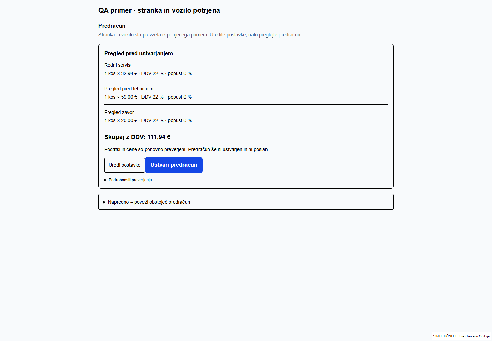
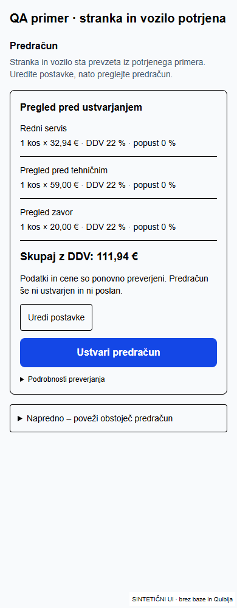
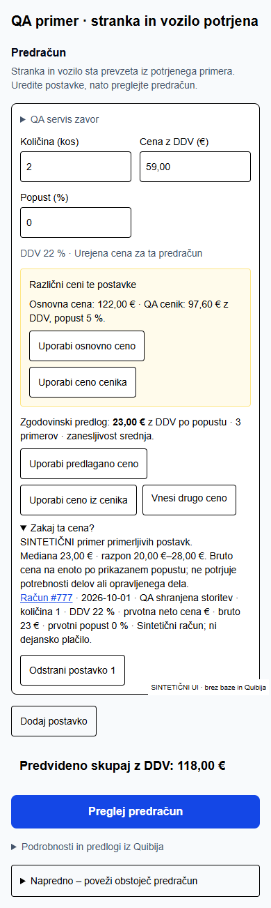
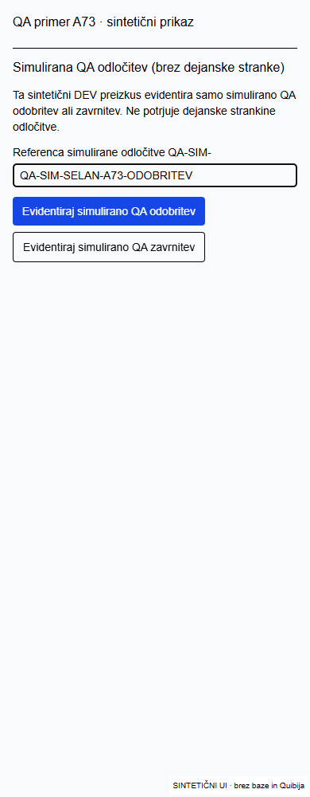

# Pametni predračuni, ročne cene in QA nadaljevanje

Obstoječi PR #19, brez nove aplikacije ali vzporednega poslovnega postopka. Obstoječi A73 / Quibi vozilo 2391 / predračun 2176932 se ne spreminjajo. Brez uporabnikovega klika ni Quibi CREATE/UPDATE/SEND ali simulirane odobritve.

## Implementirano

- Obstoječa strežniška avtomatska priprava pridobi tudi zgodovinske cenovne predloge ter jih shrani v auto_draft. Odpiranje primera uporablja shranjeno pripravo; predlog ne zamenja cene iz cenika ali ročnega vnosa.
- Preverjeni dokumentirani POST seznami /api2/predracuni, /api2/dn, /api2/fakture in /api2/dobropisi so READ operacije; GET /api2/glavadokumenta/view/ID prebere postavke. Zgodovina najprej pregleda stranko/vozilo, nato dovoljeno organizacijsko Quibi okolje. Seznami imajo 5-minutni predpomnilnik, ločen po računu in okolju; sveže podrobnosti ostajajo avtoritativne. Katalog ohranja 15-minutni predpomnilnik.
- Novi pregled uporablja dokumentirana datumska filtra datod/datdo (zadnji dve leti), aplikacijske strani po štiri podrobnosti, največ 24 podrobnosti, največ osem preverjanj dobropisov in časovno omejitev. Dokumentacija seznama dokumentov ne določa cursor/offset paginacije; parametrov ne izmišljamo. Pregled je zato omejen vzorec, ne obljuba celotne zgodovine.
- Ista šifra/ID ima prednost, sicer mora biti opis natančno enak. Količina, enota, DDV in popust se ne mešajo. Pregled zavor ni menjava ploščic ali diskov. Drugo vozilo je označeno samo kot orientacija, ker primerljivost vozila ni potrjena. Ni samodejnega izbora delov ali ur iz zgodovine.
- Veljavnost, datum, številka in cene dokumenta morajo biti preverljivi. Neznan status, stornirani dokumenti, nepreverljivi podatki ter stranke z dobropisi, katerih povezave ni mogoče varno razrešiti, se iz cenovne statistike izključijo. Predračun ostane izrecno označen kot predračun, brez dokaza izvedbe ali plačila. Račun ima prednost pred nalogom in predračunom. Identicalni dnevni dokazi se deduplicirajo.
- Predlog pokaže izvor, datum, količino, enoto/DDV/popust, neto/bruto izhodišče, mediano, razpon, število dokazov in omejitve zaupanja. Primerjave so pod »Zakaj ta cena?«. Uporaba predloga je izrecna; aktualna cena in druga ročna cena ostaneta možnosti. Če dokazov ni: »Ni dovolj primerljivih podatkov«.
- Denarna aritmetika množi decimalne vrednosti in zaokroži na cente s celoštevilsko aritmetiko. Ročni bruto vnos ostane ločen od Quibijeve enotne neto cene. Polji za ceno sprejmeta vejico/piko ter nimata številčnega koraka, ki lahko nenamerno spreminja vrednost. Pregled preveri tudi kodirani bruto seštevek pred CREATE; dejanski odgovor Quibija se po uporabnikovem CREATE še vedno strogo preveri in negotov izid zaklene ponovitve. Quibi nima dokumentiranega ločenega API-ja za izračun pred CREATE, zato takega klica ne trdimo.
- A73 je prepoznan kot točno določen sintetični DEV primer (ID, naziv, email, VIN, testni opis), ne samo poljubno ime TEST. UI in strežnik zahtevata QA-SIM- referenco, administrator/lastnik in gostovani DEV. Produkcijska pravila so nespremenjena. Običajni odgovor za A73 v DEV je zavrnjen, simulacija ne zahteva izmišljene dostave. Nadaljevanje uporabi obstoječo RPC, SHA različice in poslovne varovalke.
- A73 ostane v nadaljnjem DEV pregledu/zaključku označen kot simuliran. Ne ustvarjamo dokazila o dejanskem popravilu, prevzemu ali plačilu.
- Samodejna navigacija po osvežitvi ne premika več zaslona; eksplicitne povezave še odprejo pravo vsebino. Realtime in samodejno osveževanje čakata med fokusom ali neshranjenimi spremembami. CAS shranjevanje ostaja; neuspešna sočasna sprememba ohrani vnose na zaslonu. Po uspešnem predogledu se stari lokalni poziv o nejasnosti umakne. Glavni poslovni gumb ostane v aktivnem pregledu.
- Obračun splošnega predhodnega pregleda ostaja dovoljen šele po opravljenem pregledu in odločitvi not_ordered; pregled pred tehničnim je iz te poti izključen. Pozitivna cena pri imenu »brezplačni« ni samodejno nič.

## Opažena razlika cen

Dejanska baza je ob začetku vsebovala 58.97 in 19.96 v auto_draft.rows; predračun ima 111.87. Samo iz shranjenih podatkov ni mogoče dokazati, ali sta bila prvotna uporabnikova vnosa drugačna. Ne trdimo, da je dokazano samodejno prepisovanje 59/20. Regresijski preizkus vnosa 32.94 / 59.00 / 20.00 (tudi vejica) ohrani 111.94 v osnutku, JSON serializaciji, ponovnem nalaganju, strežniškem pregledu in Quibijevem payload-u. Obstoječega dokumenta nismo popravljali.

## Preverjanje

- 88 ciljnih testov: zgodovina, izvor, različni dokumenti/storitve/vozila/DDV/enote, popusti, odsotnost zgodovine, ročne cene, sveži ceniki, priprava in nadaljevanje, obstoječe poslovne varovalke, pregled/zaključek in realtime scheduler.
- 8 testov dejanskih strežniških akcij z izoliranimi adapterji: QA dovoljenja/odločitve brez dostave, vozilo/nadaljevanje in dashboard regresija. Noben test ne ustvari dejanskega Quibi dokumenta.
- Hidrirani realni urejevalnik pri 1440/390/350 px: vnos 59,00 in 20,00, save/reload fixture, pregled 111,94, zgodovinska cena samo po izrecnem kliku, QA-SIM brez navadne odobritve in brez dostave. 42 navigacijskih in 15 shell/mehaniških scenarijev.
- Prijavljeni E2E ni potrjen: CUA še vrne failed to write kernel assets. Samostojna testna seja ni uporabnikova prijava. Shranjevanje v UI testu uporablja izolirani adapter, ne dejanske Supabase baze.

## Ročni preizkus po objavi

1. Odpri #A73DB6BE, preveri obstoječi 2176932 / 282/2026 / 111,87 €. Ne ustvarjaj novega predračuna.
2. Odpri Odobritev, vpiši QA-SIM-SELAN-A73-ODOBRITEV in sam izberi »Evidentiraj simulirano QA odobritev«.
3. Preveri naslednje opravilo delovnega naloga. Njegov nastanek zahteva tvoj nov izrecni klik; potem dodeli testnega mehanika.
4. V mehanikovi testni seji dodaj izrecno označene QA zapiske/fotografije/status. Vodja preveri napredek in pregleda dokazila.
5. Šele po pregledu dela odpri pripravo računa; CREATE računa ostane tvoj izrecni klik. Preveri PDF, postavke, DDV in znesek. QA zaključek ni dokaz dejanskega plačila ali prevzema.
6. Cene 59/20 preizkusi na drugem novem sintetičnem osnutku brez Quibi CREATE; A73 in njegov predračun ostaneta nedotaknjena.

## Smernice in viri

Prebrane AGENTS.md, CLAUDE.md in lokalna Next.js dokumentacija use-server v C:/Users/Admin/.codex/worktrees/selan-p0-guided-case/m3-m4-ci-db-tests-v1; C:/Users/Admin/.ai-os/ORCHESTRATION_GUIDE.md; C:/Users/Admin/.agents/skills/ai-orchestrator/SKILL.md; security-review/SKILL.md; superpowers/systematic-debugging/SKILL.md; superpowers/verification-before-completion/SKILL.md; deploy-to-vercel/SKILL.md. Supabase veščina: C:/Users/Admin/.codex/plugins/cache/openai-curated-remote/supabase/1.0.0/skills/supabase/SKILL.md; Vercel deployments-cicd in vercel-cli v C:/Users/Admin/.codex/plugins/cache/openai-curated-remote/vercel/0.54.1/skills/. [Quibi dokumentacija](https://navodila.quibi.net/za-razvijalce/).

## Dejanski Quibi DEV rezultat in objava

- [READ dokaz](quibi-dev-read.json): 282 predračunov, 271 delovnih nalogov, 258 računov (811 zapisov v seznamih skupaj; ne 811 cenovnih dokazov). 24 podrobnosti v omejenem zgodovinskem vzorcu: 23 računov in en predračun. Noben vrnjen status ni znan; devet podrobnosti prestane tudi konservativno preverjanje odsotnosti dobropisov, vendar brez statusa ne postanejo cenovni dokaz. Za tri zahtevane storitve je trenutno **0 uporabnih zgodovinskih cenovnih dokazov**.
- [Dodatni READ dokaz](quibi-dev-metadata.json) neposredno potrjuje obstoječi predračun 2176932 / 282/2026 / 111.87, delovni nalog 2176930 / 271/2026 / 65.00 in račun 2176931 / DELAVNICA-A-26000260 / 65.00. Zadnja dva sta iz prej obstoječega drugega sintetičnega scenarija; nista nova dokumenta A73. Vsi imajo po tri postavke. Statusi.id in Statusi.naziv sta null. Daljši izhod drugega builda je bil odrezan; dokaz ohrani samo v celoti zajete zapise in to izrecno označi.
- PDF 2176932 se vrne kot veljaven PDF, velikost 1.187.153 bajtov. To je preverjanje dostopnosti/formata, ne vizualni pregled novega računa. SHA podatkov dokumenta ostaja fb0e146befb8f331fa06eab404531f49c83cc31038f3afadb37f805ce578c400. PDF se generira sproti in njegov hash se lahko razlikuje; ne uporabljamo ga kot SHA poslovne vsebine.
- Dejanske postavke: 32.94, 58.97, 19.96 bruto; neto 27, 48.33606557, 16.36065574; vse količina 1, DDV 22 %, popust 0. Quibi torej ohranja nižji vrednosti, ki sta bili že v osnutku. Prvotnega uporabnikovega vnosa nimamo neodvisno zabeleženega, zato izvora razlike ne pripisujemo samovoljno pretvorbi ali uporabniku.
- 31 GET in 18 dokumentiranih READ POST v prvem auditu (vključno s PDF); WRITE=false, SEND=false. Drugi build doda neposredni READ znanih sintetičnih dokumentov. Nova Quibi vozila, dokumenti, odobritve ali sporočila niso ustvarjeni.
- Funkcionalni runtime commit **07a5c9d452080421386cf71f0079793c50f3293b**, glavna implementacija a1ca86d9df10367e38877a60c3bc254b4acc5bff. Preview **READY**, dpl_3RTuSVjR9HGfJEuZAx3SJGuQFHiw, projekt avtoservis-selan-dev / prj_OSpIMwU9zkrcImKhGxpaq8PnrgUU, ekipa azalar7-langs-projects. [Stalni DEV](https://selan-dev-pr19-azalar7-langs-projects.vercel.app), [nespremenljiva objava](https://avtoservis-selan-f56q90180-azalar7-langs-projects.vercel.app).
- Next.js webpack build, TypeScript in ciljni ESLint uspešni. Testi: 88 ciljnih + 19 journey + 8 strežniških = **115**, brez napak. Poleg tega hidrirani UI pri treh širinah, 42 navigacijskih in 15 shell/mehaniških scenarijev. Končni skupni zagon 88 ciljnih testov vključuje tudi regresijo zaokroževanja mediane.
- Zadnji READ baze: A73 preparing_offer, approved_for_send, customer_decision=null, 0 work_order in 0 invoice operacij. Po uporabnikovi QA odobritvi je obstoječa pot do naloga pripravljena. Prijavljenega E2E za odobritev → nalog → mehanik → račun/zaključek nismo izvedli in ga ne označujemo kot potrjenega.
- [Osnutek vprašanj za Quibi](quibi-developer-message.md) je pripravljen, ne poslan. Manjka preverjena semantika veljavnosti/storna in povezav dobropisov za uporabo dejanskih zgodovinskih cen. Tega ne nadomeščamo z ugibanjem.

Obstoječi potrjeni predračun se ne preračunava. Zgodovinski podatki se avtomatsko shranijo ob novi samodejni pripravi osnutka; že ustvarjenih dokumentov ne osvežujemo ali prepisujemo. Deli/ure niso samodejno potrjeni; iz starega dokumenta ne sklepamo, da so potrebni tudi zdaj.
