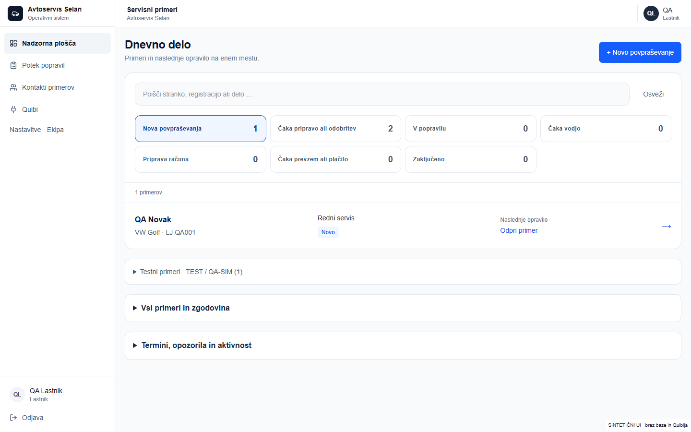
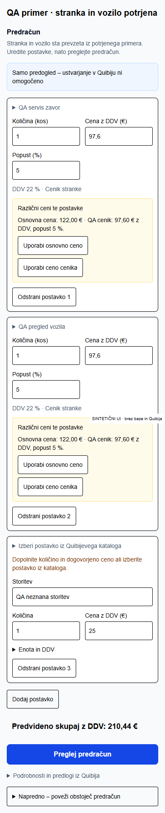
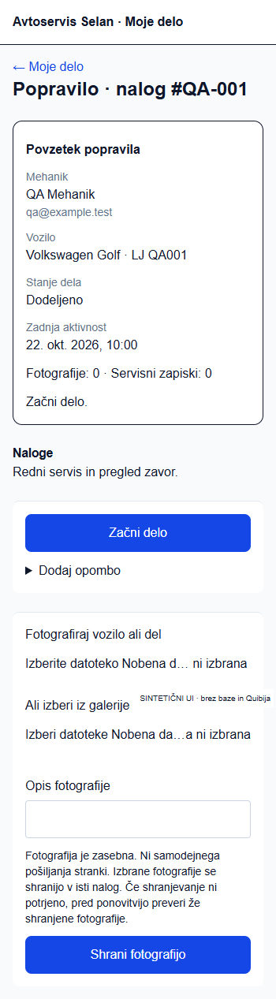

# Tadej: vsakodnevno delo

Odpri [DEV aplikacijo](https://selan-dev-pr19-azalar7-langs-projects.vercel.app/dashboard). Ta različica uporablja Quibi DEV. Ni produkcija.

TEST/QA-SIM primeri so ločeni v zloženem razdelku **Testni primeri**; glavni števci prikazujejo resnično dnevno delo. [Kratek ročni preizkus shranjevanja, osvežitve in dveh sej](qa/selan-redesign/manual-e2e-2026-10-23.md).

1. Na nadzorni plošči izberi **Novo**, **Čaka odločitev**, **V delu** ali **Zaključeno**. Išči po stranki, vozilu ali delu. Odpri primer oziroma njegovo naslednje opravilo.
2. V primeru so na vrhu stranka, vozilo, želje stranke in pripravljeni podatki. Glavni gumb odpre trenutno opravilo. Če osnovni podatki še niso potrjeni, uredi samo manjkajoče podatke istega primera.
3. Pri predračunu so zahtevane storitve že razdeljene v vrstice. Zanesljiva ujemanja dobijo Quibijeve cene. Če katalog ni na voljo, storitve ostanejo kot proste postavke: dopolni manjkajočo količino in dogovorjeno ceno. Aplikacija cen in neznanih količin ne ugiba. Enota, DDV, vrsta prodaje in skladišče se prevzamejo iz potrjenih nastavitev.
4. Izberi **Preglej predračun**, nato **Ustvari predračun**. Podatki in zneski se preverijo v ozadju. Tega istega pregleda ni treba ponovno potrjevati po uspešnem ustvarjanju. Če ustvarjanje ni omogočeno, piše **Samo predogled – ustvarjanje v Quibiju ni omogočeno**.
5. Ustvarjen predračun še ni poslan in še ni odobren od stranke. Quibi DEV e-pošte ne pošilja. Dejanski odgovor zabeleži ločeno pri **Zabeleži odobritev stranke** z dokazljivo referenco. Za test uporabljaj samo izrecno označeno odločitev **QA-SIM** na sintetičnem primeru.
6. Po odobritvi izberi **Ustvari delovni nalog**. Postavk ne prepisuj: prevzamejo se iz preverjenega predračuna. Vodja dodeli delo mehaniku. Mehanik v **Moje delo** izbere **Začni delo**, doda opombo ali zasebno fotografijo in ob koncu izbere **Končaj delo · predaj vodji**. To še ne izda računa, ne potrdi plačila ali prevzema. Vodja opravi poslovni pregled, račun in zaključek po obstoječem postopku.

Ročno povezovanje ID-ja je samo v **Napredno – poveži obstoječ predračun**, kadar že imaš dokument izven aplikacije. Ni obvezno. Pri neznanem izidu ne ustvarjaj ali pošiljaj znova; preveri obstoječi poskus.

## Kaj je dejansko preverjeno

V Quibi DEV so s tremi prostimi storitvami dejansko ustvarjeni, ponovno prebrani in povezani **predračun #2176929 → nalog #2176930 → račun #2176931**, vsak **65,00 EUR**. Cene 30/20/15 EUR in količine 1 so izrecni sintetični testni vnosi, ne servisni cenik. Odobritev je shranjena kot QA-SIM, zaključek dela v API preizkusu je sintetična testna predpostavka. Ni dokaz dejanskega popravila ali odgovora resnične stranke. Nič ni poslano.

**Celoten prijavljeni E2E, vključno s shranjevanjem mehanikovih opomb/fotografij in zaključkom prek dejanske seje, ostaja nepreverjen.** Spodaj so posnetki resničnih komponent v izoliranem sintetičnem prikazu. [Rezultati in omejitve](qa/selan-redesign/README.md).

## Novi Quibi katalog, 24. 10. 2026

Priprava zdaj uporablja novi paginirani seznam. Redni servis lahko že dobi Quibijevo ceno samodejno. Pri predtehničnem pregledu preveri možnost z nazivom »brezplačni« in pozitivno ceno; aplikacija je ne izbere namesto tebe. Pregled zavor ostane prazna prosta storitev, dokler ni preverjene ustrezne postavke ali dogovorjene cene. Ne izbiraj drugega posega samo zaradi podobnega naziva. [Dejanski rezultati novega kataloga in posnetki](qa/quibi-catalog-2026-10-24/README.md).

## Samodejna priprava po vnosu

Po »Ustvari povpraševanje« se povezovanje in priprava nadaljujeta na strežniku; ni treba posebej zagnati sinhronizacije ali odpreti dodatnega obrazca. Ko je identiteta preverjena, se osnutek shrani. V primeru se prikaže pregled, izbira nejasne storitve ali zahteva za manjkajočo ceno. Popravki se shranijo ob zapustitvi polja in pred pregledom. Če se prikaže opozorilo o neuspelem shranjevanju, pred odhodom preveri izid.

Klik »Preglej predračun« pri samodejno pripravljenem osnutku opravi tudi obstoječi sprejem; dodatnega potrditvenega polja ni. Ustvarjanje dokumenta ostane ločeno po pregledu. Nejasno identiteto oziroma novo nepotrjeno vozilo mora najprej preveriti pooblaščeni uporabnik. [Kaj je dejansko preverjeno in kratek ročni preizkus](qa/selan-automatic-preparation-2026-10-24/README.md).
