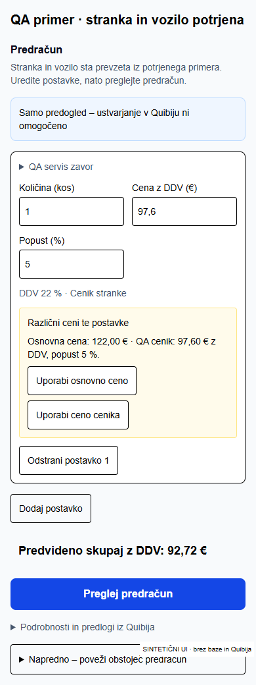
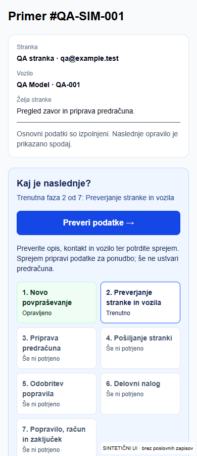
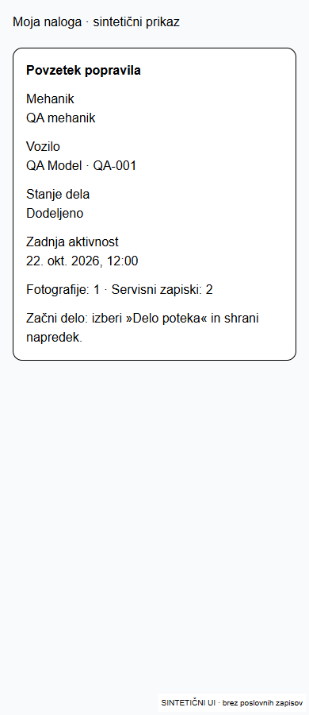
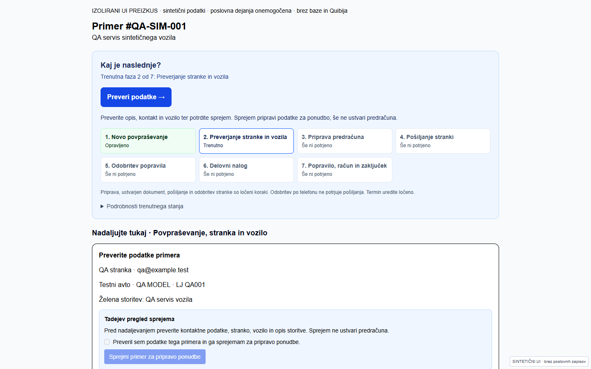
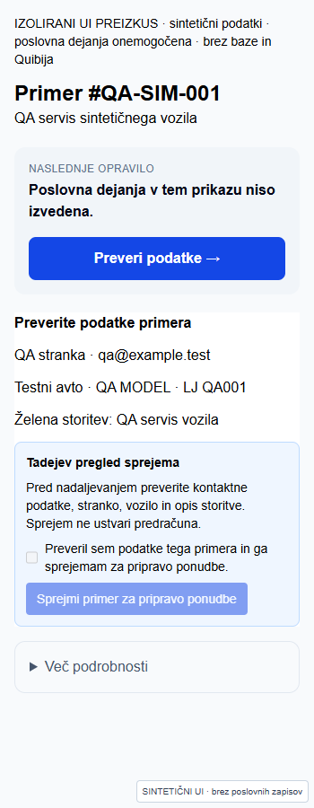
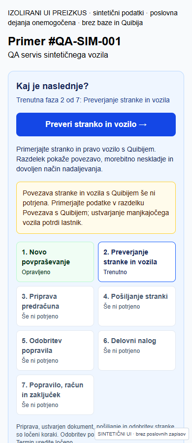
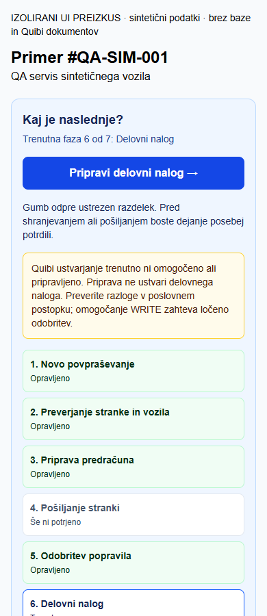
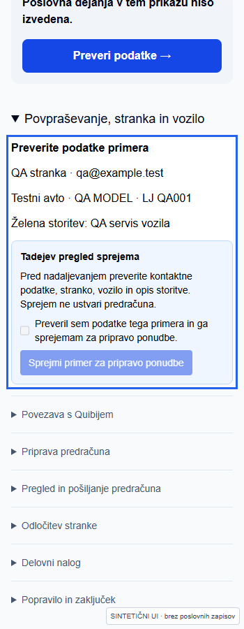
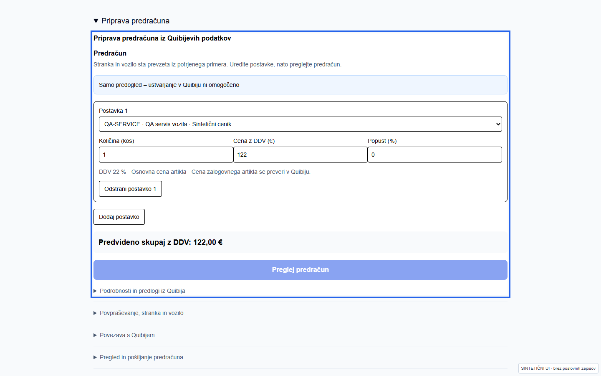
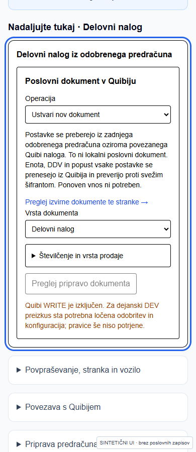

# Tadej: od novega povpraševanja do naloga

**Stanje 22. 10. 2026:** navodila za kodo v tem PR; trenutni naslov in commit DEV Previewa sta navedena v opisu PR. Dejanski Quibi DEV CREATE in samodejna povezava sta potrjena za sintetični dokument #2176924; testno pošiljanje #277127 je končalo s stanjem failed. Celoten prijavljeni uporabniški postopek ostaja nepreverjen. Spodnji posnetki so dejanski Playwright posnetki delovnega prostora in obstoječih komponent obrazcev v izoliranem prikazu; niso posnetki prijavljenega primera ali dokaz ustvarjenih dokumentov.

[Aktualni dejanski rezultat in blokade DEV](qa/selan-estimate-workspace/dev-automation-2026-10-22.md).

## Priprava predračuna: običajna pot

1. Odpri **Pripravi predračun**. Stranka in vozilo ostaneta iz potrjenega primera. V enem urejevalniku so vse navedene zahteve, postavke, količine, cene, popusti in predvideni skupni znesek. Jasna ujemanja iz dostopnega Quibi kataloga so že izpolnjena; pri nejasni vrstici izberi enega od predlogov.
2. Popravi le potrebno količino ali ceno. Različni ceni sta prikazani pri postavki. Cena zalogovnega artikla ostane omejena na preverjeno pot Quibi; tega opozorila ne obidi z drugim povpraševanjem.
3. Klikni **Preglej predračun**. Aplikacija sama pripravi obstoječe podatke in preveri aktualne cene; ločena priprava in ponovno potrjevanje stranke/vozila nista potrebna. V pregledu lahko izbereš **Uredi postavke**.
4. Če je ustvarjanje omogočeno, klikni **Ustvari predračun**. Če piše **Samo predogled – ustvarjanje v Quibiju ni omogočeno**, dokument ni ustvarjen. Pregled in ustvarjanje ne pošljeta predračuna stranki.

Obstoječi predračun, ustvarjen zunaj aplikacije, povežeš samo po potrebi v zaprtem razdelku **Napredno – poveži obstoječ predračun**. To ni obvezna pot priprave. Pri neznanem izidu CREATE izberi **Osveži in preveri izid**; novega dokumenta ne ustvarjaj znova.

Naslednji posnetek je hidriran sintetični preizkus dejanskega urejevalnika, ne posnetek prijavljene gostovane seje:

[Preverjanje in točne omejitve prijavljenega pregleda](qa/selan-estimate-workspace/README.md).

1. Na nadzorni plošči v **Dnevno delo** poišči primer in klikni njegovo naslednje opravilo. Čakalna vrsta prikazuje vse odprte primere; filtriraj jih po vrsti dela ali išči po stranki, registraciji, številki oziroma storitvi. **Osveži dnevno delo** ponovno prebere trenutno stanje. Spodnji pregled po obdobju je dodatni pregled, tudi za zaključene primere. Na vrhu primera je **Kaj je naslednje?**, trenutna faza in en moder gumb. Nad opravili je vedno viden povzetek: stranka, vozilo, želja stranke in seznam manjkajočih osnovnih podatkov. Trenutni obrazec je takoj pod koraki, označen z **Nadaljujte tukaj**. Ko se po shranjevanju osveži stanje primera, se naslednje opravilo preračuna iz tega stanja; sam klik gumba še ne potrdi uspeha. Ostala opravila so zložena in jih lahko odpreš. Gumb te odpelje do ustreznega obrazca; sam še ničesar ne pošlje ali ustvari.
2. Če piše **Preveri stranko in vozilo**, preveri povezavo s Quibijem. Primerjaj stranko in pravo vozilo. Če ustvarjanje ali povezava nista dovoljena, upoštevaj prikazani razlog; potreben je lastnik ali skrbnik.
3. Pri **Preveri podatke** preveri opis, kontakt in vozilo. V Tadejevem pregledu označi potrditev in klikni **Sprejmi primer za pripravo ponudbe**. To sprejme primer in pripravi podatke; še ne ustvari predračuna.
4. **Pripravi predračun** odpre enoten urejevalnik zgoraj. Ob kliku **Preglej predračun** se priprava podatkov izvede samodejno. Predogled ni dokument; ustvarjanje potrdiš šele iz pregleda, kadar je omogočeno.
5. **Preglej in potrdi predračun** odpre dejanske postavke, znesek in pregled. Potrdi **Odobri predračun**. S tem dokument še ni poslan in stranka še ni naročila popravila.
6. **Pošlji predračun** je ločeno dejanje in zahteva omogočen SEND ter preverjeno vsebino in prejemnika. DEV dovoljuje samo odobren testni naslov. Če pošiljanje ni omogočeno, dokument ni poslan. Pri neznanem izidu ne ponavljaj pošiljanja.
7. **Zabeleži odobritev stranke** odpre odločitev za to različico predračuna. Vnesi sledljiv dejanski odgovor, tudi po telefonu, in potrdi odločitev. Status pošiljanja ni odobritev. Pri sintetičnih testih uporabljaj samo označeno simulacijo QA-SIM.
8. Po veljavni odobritvi **Pripravi delovni nalog** oziroma **Ustvari delovni nalog** odpre obstoječi poslovni obrazec. Prevzame podatke preverjenega predračuna. Pred ustvarjanjem preveri pogoje. Če WRITE ni omogočen, nalog ni ustvarjen. Ko nalog že obstaja, gumb vodi na njegov pregled oziroma popravilo.

**Če obstaneš:** rumeno pojasnilo pod glavnim gumbom pove razlog in naslednjo pot. Podatkov, ki so že shranjeni, ne vnašaj v novo povpraševanje. Dnevniki, dokumenti, AI in tehnična aktivacija ostajajo dostopni v podrobnostih. Ročni termini so ločeni; ta popravek ne uvaja novega sistema terminov.

## Mehanik: dodeljeno delo

Mehanik v **Moje dodeljeno delo** odpre svoj dodeljeni primer. Povzetek pokaže vozilo in registracijo, stanje dela ter naslednje opravilo za mehanika. Pod njim sta **Težava** in, če je v primeru vneseno, **Zahtevano delo in navodila**. Postavke dela in materiala se berejo iz preverjenega Quibijevega naloga; če sveže branje ni mogoče, to prikaz pove. Tak prikaz ni potrditev razpoložljivosti delov.

V **Zabeleži opravljeno delo** izberi napredek, dodaj opombo in klikni **Shrani napredek in opombo**. Fotografiranje oziroma izbira iz galerije je takoj za tem, pred zgodovino zapiskov. Dodaj opis in klikni **Shrani fotografijo**; za več fotografij ponovi. Fotografije so zasebne. Če nalaganje ni potrjeno, preveri obstoječo datoteko v prikazanem seznamu nedokončanih nalaganj, preden jo nalagaš znova.

Ko je delo opravljeno, izberi **Delo opravljeno** in shrani napredek. To preda delo vodji; ne izda računa, ne potrdi plačila ali prevzema in ne pošlje sporočila. Naslednje navodilo mehaniku ostaja vezano na njegovo delo; poslovni pregled in zaključek ureja vodja. Pri zaključenem primeru sta običajna obrazca za napredek in novo fotografijo skrita; ponovno obravnavo lahko odpre vodja.

## Novi predogledi primera in mehanika

Naslednja posnetka sta **hidrirana sintetična predogleda komponent** pri širini 390 px. Prikazujeta povzetek primera oziroma mehanikov povzetek z navodilom za naslednje opravilo. **Nista posnetka prijavljene dejanske aplikacije. Celoten E2E z dejansko aplikacijo, zaledjem, bazo in Quibijem ostaja nepreverjen.**

## Posnetki izolirane komponente

Novo povpraševanje, 1440 px:

Novo povpraševanje, 350 px:

Nepotrjena povezava vozila:

Priprava naloga ob izključenem WRITE:

Priložen je [kratek video UX navigacije](qa/selan-p0-2026-10-22/ui-navigation.webm). Prikazuje štiri ločena sintetična stanja in odpiranje obrazcev; poslovni gumbi so v prikazu izključeni. **To ni video dokončanega postopka ali E2E.** [Dokazi in omejitve preverjanja](qa/selan-p0-2026-10-22/README.md).

## Trenutni obrazci po kliku glavnega gumba

Lokalni UX predogled brez poslovnih zapisov: `node scripts/qa-case-journey.mjs --serve`, nato `http://127.0.0.1:47866/?case=new`. Prikaz ni prijavljena DEV aplikacija.
